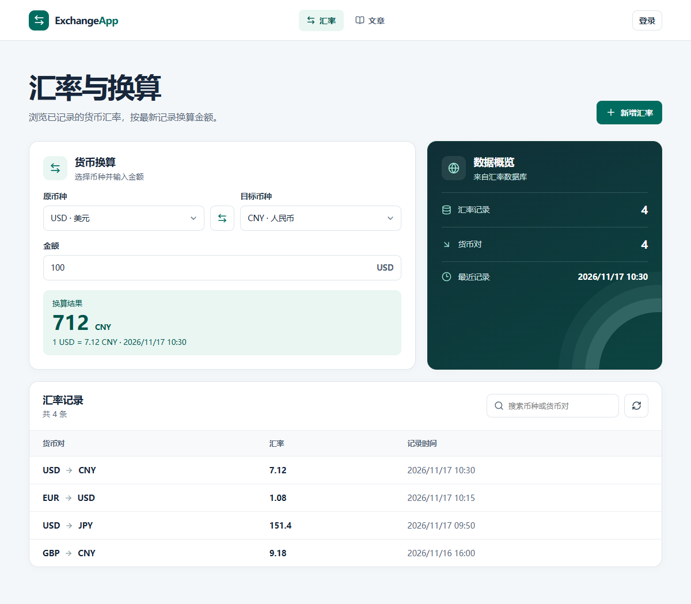
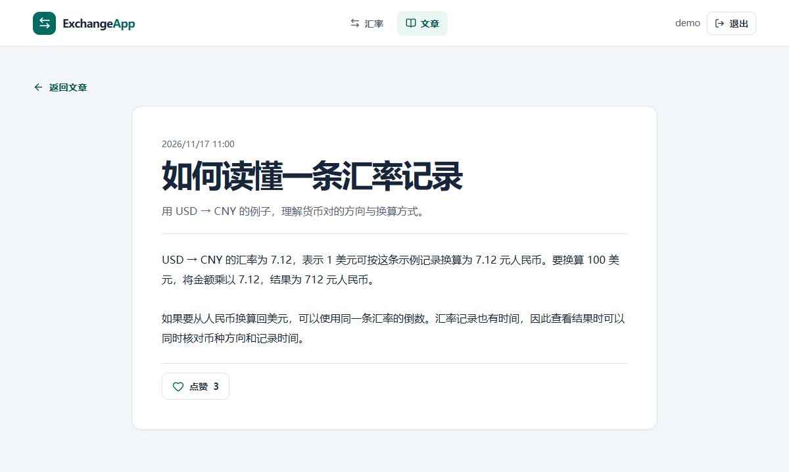
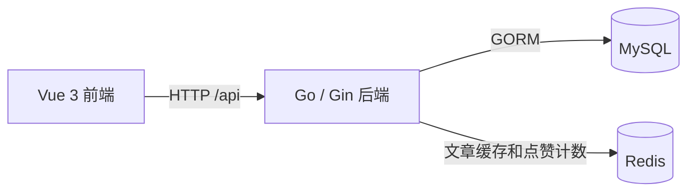

# ExchangeApp

一个用 **Go、Gin 和 Vue 3** 实现的全栈学习项目，围绕汇率记录、货币换算和文章分享，练习从 REST API 到浏览器交互的完整开发流程。

[界面预览](#界面预览) · [项目功能](#项目功能) · [快速开始](#快速开始) · [接口概览](#接口概览) · [代码导览](#代码导览) · [学习来源](#学习来源)

## 界面预览

以下为实际页面截图，汇率和文章均使用示例数据。



<details>
<summary>查看文章详情与点赞界面</summary>



</details>

## 项目功能

| 功能 | 可以做什么 |
| --- | --- |
| 汇率记录 | 无需登录即可浏览和搜索已有记录，登录后可新增汇率。 |
| 货币换算 | 根据最新的有效记录换算金额。缺少直接汇率时，使用反向汇率的倒数。 |
| 账户 | 注册、登录和退出。前端在当前标签页保存登录状态。 |
| 文章与点赞 | 登录后可浏览文章、查看详情、发布文章和点赞。 |

汇率由用户录入，换算结果以数据库中的记录为准。

## 快速开始

需要 **Go 1.26.10+**、**Node.js 20.19+ 或 22.12+**，以及可连接的 **MySQL** 和 **Redis** 实例。

### 1. 获取代码

```sh
git clone https://github.com/ChanYanny/ChanYanny-ExchangeApp.git
cd ChanYanny-ExchangeApp
```

### 2. 配置并启动后端

先在 MySQL 中创建一个空数据库，例如 `exchange_app`。编辑 [backend/config/config.yml](backend/config/config.yml)，将 `database.dsn` 和 Redis 连接信息改成你本机的配置。

```yaml
app:
  name: ExchangeApp
  port: ":3000"

database:
  dsn: "your_user:your_password@tcp(127.0.0.1:3306)/exchange_app?charset=utf8mb4&parseTime=true&loc=Local"
  max_idle_conns: 10
  max_open_conns: 100

redis:
  addr: "127.0.0.1:6379"
  password: ""
  db: 0
```

从仓库根目录进入 `backend`。后端会从当前目录读取 `config/config.yml`，启动时由 GORM 创建或迁移数据表。

```sh
cd backend
go run .
```

后端默认监听 `http://localhost:3000`。可打开 [汇率接口](http://localhost:3000/api/exchangeRates) 检查是否返回 JSON。

### 3. 启动前端

另开一个终端，从仓库根目录运行：

```sh
cd frontend
npm ci
npm run dev
```

打开 Vite 打印的地址，通常是 [http://localhost:5173](http://localhost:5173)。开发时，Vite 会把 `/api` 代理到 `http://127.0.0.1:3000`。如果后端使用其他地址，从 `frontend/.env.example` 创建 `frontend/.env.local`，并修改 `API_PROXY_TARGET`。构建命令和部署配置见 [前端 README](frontend/README.md)。

首次体验可以注册账户，新增一条 `USD → CNY` 的示例汇率，再回到首页查看记录并换算金额。

## 接口概览

| 方法 | 路径 | 登录要求 | 用途 |
| --- | --- | --- | --- |
| POST | `/api/auth/register` | 公开 | 注册并获取令牌 |
| POST | `/api/auth/login` | 公开 | 登录并获取令牌 |
| GET | `/api/exchangeRates` | 公开 | 查询汇率记录 |
| POST | `/api/exchangeRates` | 需要登录 | 新增汇率记录 |
| GET | `/api/articles` | 需要登录 | 获取文章列表 |
| POST | `/api/articles` | 需要登录 | 发布文章 |
| GET | `/api/articles/:id` | 需要登录 | 查看文章详情 |
| GET | `/api/articles/:id/likes` | 需要登录 | 查询点赞数 |
| POST | `/api/articles/:id/likes` | 需要登录 | 点赞并增加计数 |

调用受保护接口时，将登录或注册响应中的 `token` 原样放入 `Authorization` 请求头。响应值已包含 `Bearer ` 前缀。路由定义见 [router.go](backend/router/router.go)。

## 代码导览



| 从这里开始 | 可以看到的实现 |
| --- | --- |
| [backend/router](backend/router) 和 [backend/middlewares](backend/middlewares) | Gin 路由分组和 JWT 鉴权中间件。 |
| [backend/controllers](backend/controllers) 和 [backend/models](backend/models) | 请求处理、GORM 数据模型与 MySQL 持久化，以及用 Redis 缓存文章列表和记录点赞数。 |
| [frontend/src/api.ts](frontend/src/api.ts) | TypeScript 接口类型、统一请求与会话处理。 |
| [frontend/src/views](frontend/src/views) | Vue 3 页面、汇率换算、登录注册与文章交互。 |

## 学习来源

本项目是个人学习练习，参考了 Inkka Plum 的 Go、Gin、GORM、Vue、Redis 和 MySQL 教程。感谢原作者整理案例代码与配套课件。 [Web003Gin-01_gingormtutorials](https://github.com/Slumhee/Web003Gin-01_gingormtutorials)
